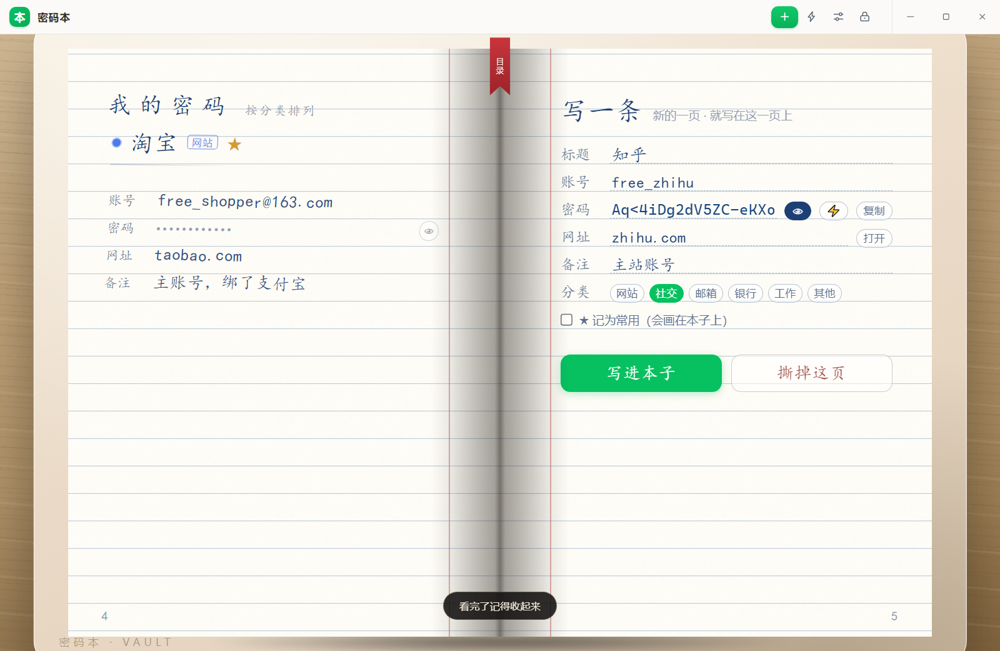
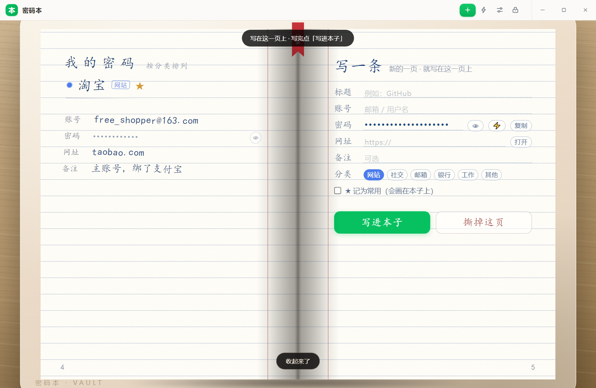
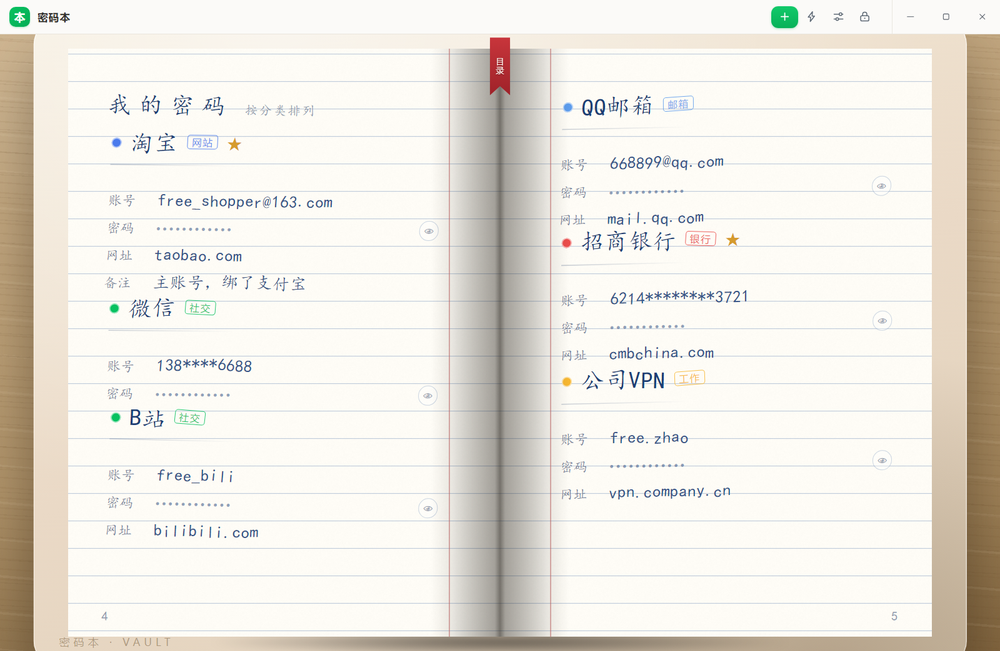

# 密码本 v1.1.0（Windows）

> 一本**只存在你自己电脑里**的手写密码本：输主密码翻开一本本子，一页写一条，
> 能用鼠标或方向键翻页、点目录跳页，也能随时在本子上再写一条。数据全密文，不上传任何服务器。

安装包：`dist\密码本 Setup 1.1.0.exe`（约 80 MB，未签名）

---

## 这一版做了什么

### 1) 记忆不再"默认露脸"：👁 输主密码才看

- 本子上每一条的密码行右边、写的那一页密码列旁边，都有一颗 **👁**
- 点它 → 输入本子的主密码 → 验过才把**这一条**显示出来（等宽字体，`0/O`、`1/l` 一眼分得清）
- 密码不对：原地提示「主密码不对，再试一次」，框留着接着输；再点一下 👁 收回去，**明文同时从界面上清掉**
- 底层只做"验密码"，**不换会话、不重新解锁**；点密码那行仍然是"复制"（不想被看见就盲拷）



### 2) 字与清晰度

- 纸面上的字改成**国标楷体**（`KaiTi` / `楷体_GB2312`），不再依赖行楷、舒体那类"看运气装没装"的字体
- 排版层从 `transform: scale()` 换成**真布局缩放 `zoom`**，并把缩放**对齐到整数物理像素**，
  再打开系统次像素抗锯齿（ClearType）—— 125% 系统缩放下笔画不再糊一圈、横线也实了

### 3) 写 / 改 都有"动作"，衔接是事件驱动的

- **写一条**：先**翻一页过去**（不是跳），翻到了才落下一张新纸，表格**一行一行写出来**
- **改这一条**：像墨迹化开，聚成一张能写的表格
- **写进本子 / 不写了 / 撕掉这页**：各有收尾动作，而且**动画播完才重排**（不会演到一半被掐断）
- 动笔时机交给 turn.js 的 `turned` 事件（不再"猜 860ms"）



### 4) 底层重做了一遍（为下一步做准备）

```
src/main     主进程：生命周期 / 窗口 / 路径 / IPC 装配
src/core     加密与存储内核（不依赖 Electron，可单独跑单测）
src/preload  唯一的门：window.vaultAPI / winAPI
renderer/app 渲染逻辑：lib / toast / store / items / book / ui/*
renderer/notebook  turn.js 手写本子：model 排版 / ink 字迹 / page 整页 / sheet 编辑页 /
                   reveal 看一眼的弹框 / timing 时间常量 / notebook 引擎接线
tests/unit   单元测试（29 项）      tests/e2e  端到端（30 项）
```

- 时间/节奏只有 `renderer/notebook/timing.js` 一处定义，CSS 通过 `:root` 变量取
- 动画里去掉了 `filter: blur()` 和"整屏/整本缩放"（每帧重栅格化的元凶）；首帧提前画，过渡更顺
- 标题栏去掉左侧黑块、工具按钮去底色、补齐窗口按钮的悬停与关闭红（顺手修了一个"悬停规则被覆盖"的老 bug）


### 5) 数据文件格式：**老版本永远能读**

| 格式 | 现在怎么处理 |
| --- | --- |
| v1（很早的版本写的） | 仍能解锁、仍能读 |
| v2（上一版写的） | 仍能解锁、仍能读 —— **不会擅自改写你的文件** |
| v3（正在开发） | 多一层"数据密钥"：日常保存不再每次跑 scrypt（快），将来放图片/附件时附件各自独立加密 |

- **升级只在你保存时发生**，而且覆盖前会先把上一份留成 `vault.dat.bak`
- 主密码不需要变；换主密码只换最外面那层壳

---

## 安装与使用

1. 双击 `密码本 Setup 1.1.0.exe`（安装包**未签名**，SmartScreen 会提示"未知发布者"→ 点「更多信息」→「仍要运行」）
2. 首次打开设置一个主密码（≥ 6 位）。**请一定记住它**：忘记了谁也打不开
3. 数据放哪儿（便携式，装到哪个盘数据就在哪个盘）：
   - 安装版：`<安装目录>\data\vault.dat`
   - 开发运行（`npm start`）：`项目根\data\vault.dat`
   - 也可用环境变量 `VAULT_DATA_DIR` 指定
4. 备份 = 拷走 `vault.dat` 一个文件（它是全密文，必须配合主密码才能解密）

常用键：`Ctrl+N` 写一条 · `Ctrl+S` 保存正在写的那条 · `Ctrl+L` 合上本子（锁定） · `←/→` 翻页 · `Esc` 关弹窗

## 安全说明（可以直接写进对外说明）

- 加密：**scrypt**（N=2^15）派生密钥 + **AES-256-GCM** 认证加密；文件被改过一个字节都解不开
- 数据不出设备：没有账号、没有云同步、没有网络请求
- 👁 只看一条密码也要过主密码；收起时明文从界面清掉
- 主密码一旦遗忘无法找回（这是设计，不是缺陷）

## 演示



## 下一步（正在做）

**让它更像"档案"，而不是只记密码**——每条记录可以**贴图片、放文件**：

- 加密"附件仓"（每条附件独立加密、不进保险库 JSON）与数据密钥层已经写好
- 计划：本子上把照片像贴纸一样贴上、点开看大图；写的那一页能拖入/粘贴/选图片；
  一条记录 = 档案（名称 + 分类 + 图片若干 + 账号密码网址备注）

## 测试

```bash
npm test          # 单元测试：加密内核 / 保险库 / 数据模型 / 渲染层模块边界
npm run test:e2e  # 端到端：真窗口跑一遍 创建 → 写一条 → 👁 验密 → 翻页/目录 → 改 → 撕 → 设置 → 改主密码
```

本版打包前：单元 **29/29**、端到端 **30/30**、截图脚本全流程无报错、版式几何校验通过（行距 28px、字压横线）。
